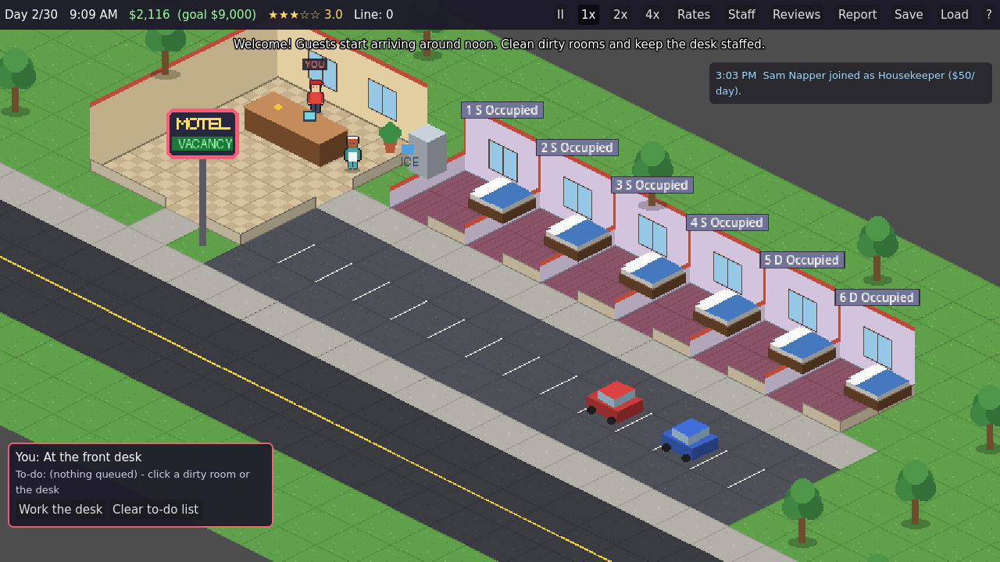
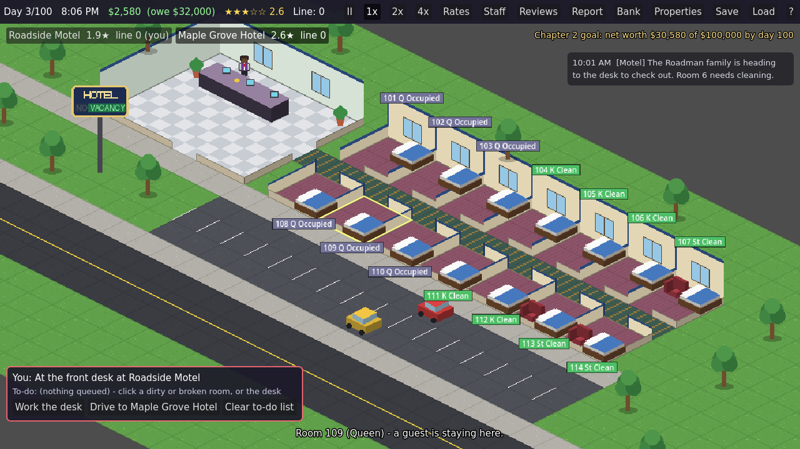

# HotelWorld

A hobby tycoon game about building a hotel empire, starting with one roadside motel.
Made with **Godot 4.3** (GDScript) and 2D isometric pixel art.

You run the motel yourself at first: check guests in at the front desk and clean rooms
after they check out. Everything takes time. If the line gets long or a room isn't clean
when a guest arrives, they get upset, ask for discounts and leave bad reviews. Your
rating decides how many guests come and how much they'll pay. Once you can afford it,
hire a front desk clerk and housekeepers, and set room rates and wages.

Save up, and the Maple Grove Hotel is yours: a 14-room hotel bought with a mortgage. You
run both properties at once, with staff on day, evening and night shifts, maintenance techs
to fix what guests break, and a bank that will lend you money.




See [docs/GAME_PLAN.md](docs/GAME_PLAN.md) for the design and the roadmap (training,
promotions, amenities, a map with more properties).

## Play it (Windows or Mac)

1. Download **Godot 4.3** (standard version, not .NET) from
   https://godotengine.org/download/archive/4.3-stable/. It's a single app, no installer.
2. Download or clone this repository.
3. Open Godot, click **Import**, pick this folder's `project.godot`, then press **F5**
   (or the ▶ button) to play.

The first time you open the project, Godot spends a few seconds importing the art.

## How to play

- Guests line up at the front desk. Someone must be **at the desk** to check them in or out.
- Guests check out between **7 and 11 AM** (each at their own time) and check in from
  **3 PM**. The gap is your time to clean.
- Guests who arrive early may ask to check in early (if a clean room is free). Say no,
  charge a fee (set it under **Rates**) or let them in free. Free early check-ins earn
  better reviews; fees earn money but annoy some guests, and some will haggle.
- When guests check out, their room is **dirty**. Click a dirty room to go clean it.
- You can queue several jobs: they happen in order (see the panel bottom-left).
- Guests whose room isn't ready wait in the lobby and get grumpy. Waiting too long
  makes them leave or demand a refund.
- Guests sometimes break things when they check out (the AC, the TV, the shower...). A
  broken room can't be rented until it's fixed. Click it to fix it yourself (1 hour), or
  hire a **maintenance tech** (twice as fast).
- Staff work one **shift** each: Day 7 AM-3 PM, Evening 3-11 PM or Night 11 PM-7 AM.
  The desk is busiest for check-outs in the morning and check-ins in the evening.
- **Rates**: the nightly price per room type. **Staff**: hire, set shifts and wages, let go.
  **Reviews**: what guests think. **Report**: yesterday's numbers.
- **Bank**: borrow up to half of what your properties are worth, paid back daily over 30
  days. Pay early to save interest. **Properties**: what you own and what's for sale.
- With two properties, the tabs under the top bar (or **Tab**) switch which one you see.
  You can only be at one: jobs at the other one make you drive over (40 game minutes).
- Campaign, chapter 1: turn $1,500 into $9,000 of savings (cash minus loans) within 30
  days. Chapter 2: buy the Maple Grove Hotel (20% down, the rest on a mortgage) and grow
  your net worth (cash + property values - debt) to $100,000 by day 100. Go broke three
  nights in a row and it's over. Sandbox: no goal, no bankruptcy, and the hotel is for sale
  whenever you have the down payment.
- Old milestone 1 saves still load: they continue as chapter 1 with just the motel.

| Control | Action |
|---|---|
| Left click a room | Clean and/or fix it (if dirty or broken) |
| Left click the lobby, the line or a guest | Work the front desk |
| F | Go to the front desk |
| Tab | Show the next property |
| Drag, WASD or arrow keys | Move the camera |
| Mouse wheel, trackpad pinch or + / - | Zoom |
| Space | Pause |
| 1 / 2 / 3 | Speed 1x / 2x / 4x |
| Esc | Close a window |

The game auto-pauses while a window (report, discount request, staff, etc.) is open.

## Project layout

```
scenes/main.tscn        entry scene
scripts/main.gd         camera, input, speed, save/load, which property is on screen
scripts/sim/game.gd     the business: clock, cash, bank, campaign chapters, owner travel
scripts/sim/property.gd one property: rooms, guests, staff, shifts, repairs, desk line
scripts/sim/layout.gd   each property's map (motel, hotel) and pathfinding
scripts/view/           draws the world from the simulation state
scripts/ui/ui.gd        HUD and management windows
data/balance.json       all tuning numbers (prices, patience, wages, durations, demand)
art/                    generated pixel art (replace any PNG with your own, same size)
tools/gen_art.py        regenerates the art (python3 + Pillow)
tools/sim_30_days.gd    headless balance check with bot players (chapter 1 and the full campaign)
tests/run_tests.gd      unit tests
```

## Tweaking and testing

Most tuning is in `data/balance.json`: no code changes needed.

```bash
godot --headless --path . --script res://tests/run_tests.gd
```

```bash
godot --headless --path . --script res://tools/sim_30_days.gd
```

```bash
python3 tools/gen_art.py
```
